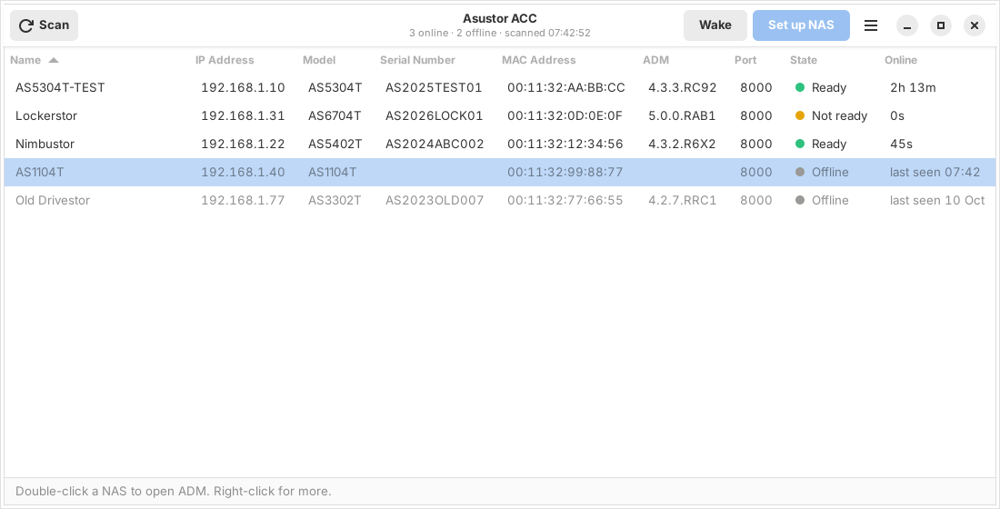

#  Asustor Control Center for Linux

A Linux version of the ASUSTOR Control Center (ACC): find ASUSTOR NAS
devices on your LAN, open the ADM web UI or the shared folders, send
Wake-on-LAN, and see each NAS's uptime. Comes as a dependency-free CLI
(`acc`) and a GTK4 GUI (`acc-gui`).

> Unofficial community project. Not affiliated with, endorsed by, or
> supported by ASUSTOR Inc. "ASUSTOR" and "ADM" are trademarks of ASUSTOR
> Inc., used here only to describe compatibility.



ASUSTOR ships Control Center for Windows and macOS only. This project
speaks the same discovery protocol, natively on Linux.

## Download

[](https://github.com/moringa303/asustor-acc-linux/releases/latest)

| Distribution | Package | Install |
|---|---|---|
| Debian, Ubuntu, Mint, Pop!_OS | [**asustor-acc-linux_amd64.deb**](https://github.com/moringa303/asustor-acc-linux/releases/latest/download/asustor-acc-linux_amd64.deb) | `sudo apt install ./asustor-acc-linux_amd64.deb` |
| Fedora, RHEL, openSUSE | [**asustor-acc-linux.x86_64.rpm**](https://github.com/moringa303/asustor-acc-linux/releases/latest/download/asustor-acc-linux.x86_64.rpm) | `sudo dnf install ./asustor-acc-linux.x86_64.rpm` |
| Arch, EndeavourOS, Manjaro, others | [**asustor-acc-linux-linux-amd64.tar.gz**](https://github.com/moringa303/asustor-acc-linux/releases/latest/download/asustor-acc-linux-linux-amd64.tar.gz) | extract, then `./install.sh` |
| CLI only, any x86-64 Linux | [**acc**](https://github.com/moringa303/asustor-acc-linux/releases/latest/download/acc) (static binary) | `chmod +x acc && sudo install acc /usr/local/bin/` |

Checksums: [SHA256SUMS](https://github.com/moringa303/asustor-acc-linux/releases/latest/download/SHA256SUMS).
All versions: [releases page](https://github.com/moringa303/asustor-acc-linux/releases).

## Features

- `acc`: single static binary, works on any x86-64 Linux distribution:

  ```
  acc scan                  # discover ASUSTOR NAS devices (table)
  acc scan --json           # machine-readable output
  acc scan --all            # also list remembered devices that are offline
  acc scan --watch          # live view, rescans every 30 s
  acc open   <name|ip|mac>  # open the ADM web UI in your browser
  acc shares <name|ip|mac>  # open the shared folders (smb://) in your file manager
  acc url    <name|ip|mac>  # print the ADM URL
  acc wol    <name|ip|mac>  # send a Wake-on-LAN magic packet
  acc ports  <name|ip|mac>  # which services answer (ADM, SMB, SSH, NFS, ...)
  acc health <name|ip|mac>  # temperatures, fans, CPU, memory, disks, volumes (SNMP)
  acc scan --subnet 10.1.2.0/24   # also ask every host of another subnet directly
  acc doctor                # diagnose "no device found" problems
  ```

- `acc-gui`: GTK4 front-end with the familiar device table
  (Model / Name / IP / Serial / MAC / ADM / Port / State), each model
  with a small glyph of its form factor (tower, rack, flash), Scan, Ping,
  Open ADM and Wake buttons, a link button that opens the selected
  model's HDD compatibility list (SSD list for the all-flash FS models)
  from asustor.com in a window of the app (see
  [Links to asustor.com](#links-to-asustorcom)), a right-click menu (open shared folders,
  copy the IP or MAC, forget a device), sortable columns, a search bar
  (Ctrl+F, or just start typing: name, IP, model, serial, MAC and state
  are matched), and an optional automatic refresh every 30 seconds (off
  by default; the menu switch is remembered). The table is the layout
  from 1000 px of window width up (cells shorten with an ellipsis and
  show the full text as a tooltip, never a horizontal scrollbar; the
  Model, ADM and State columns are always shown whole); narrower windows
  get a card list. Offline devices stay in the list, dimmed, so you can
  wake them. A NAS whose answer to one scan got lost (it happens on a
  segment with hundreds of devices) keeps its place as online until it
  has been missing for 2½ minutes, so the list does not flicker.

- Accent colour: Kiwi green by default, or Cyan, Amber, Coral or Violet
  from the menu (the stripe under the header bar, the Open ADM button,
  the Ready dots and the LEDs of the model glyphs follow). The window
  itself follows your system's light or dark theme. Choices are kept in
  `~/.config/asustor-acc/gui.json`.

- Services check: "Check services (ports)…" (Ctrl+Shift+P, also in the
  right-click menu) and `acc ports <name>` show which of the services a
  NAS commonly runs answer from your computer: ADM (8000/8001), SMB,
  SSH, FTP, AFP, NFS, rsync, iSCSI, WebDAV, MariaDB, Plex and the web
  server ports. It is one TCP connection attempt per well-known port of
  the one NAS you picked, nothing is sent, and the answer is open (a
  service accepted), closed (nothing listens) or filtered (no answer: a
  firewall drops it). Inspecting the NAS's traffic itself is not possible
  from another computer on a switched network; that needs a capture on
  the NAS or a mirror port on the switch.

- Details over SNMP: "Details (SNMP)…" (Ctrl+D) and `acc health <name>`
  show what the NAS reports about itself through the ASUSTOR MIB:
  model, processor, ADM version and whether an update is available,
  BIOS, serial, uptime, CPU load, memory, system and CPU temperature,
  fan speed, every disk with its model, type, size, temperature, status
  and SMART verdict, every volume with its RAID level, file system,
  usage and state, and the UPS (status, charge, runtime, input voltage)
  when one is attached. Both layouts of the MIB that ADM has shipped
  are understood (the older one with single values, the ADM 4 one with
  tables; both are in [`mibs/`](mibs/README.md)); the NAS's answers tell
  them apart, and the "SNMP MIB layout" setting in Preferences, or
  `acc health --mib old|new`, forces one when needed. The window
  refreshes every 15 seconds while open. It needs
  SNMP enabled in ADM (Services › SNMP, v1/v2c), like the uptime. The
  latency to the NAS is not shown in the list; the Ping button and the
  Details window give it on request.

- Restart and shut down: in the right-click menu, after a confirmation.
  The app signs in to ADM's web API with your ADM account (asked for
  once, kept in the desktop keyring with libsecret when you tick
  "remember", otherwise for the session only) and sends the power
  request. "Open ADM in a window" shows ADM itself inside the app for
  everything else, such as the network settings. ADM's power endpoints
  are not documented by ASUSTOR; if your ADM version answers with an
  error, `~/.config/asustor-acc/adm.json` can name the request your
  ADM makes (the network tab of the browser shows it when you click
  Power Off):

  ```json
  {"restart": "settings/power.cgi?act=restart", "shutdown": "settings/power.cgi?act=shutdown"}
  ```

- Notifications: a desktop notification when a NAS goes offline, comes
  back or shows up for the first time, for changes found by the
  automatic refresh or while the window is in the background. Off in
  Preferences if you prefer.

- Other subnets: multicast discovery stops at the router. Preferences
  can list subnets (`10.1.2.0/24`, up to a /22 each) whose hosts are
  asked directly with unicast mDNS queries, which ASUSTOR devices
  answer; `acc scan --subnet 10.1.2.0/24` does the same.

- Tags and notes: "Tags and note…" (F2) in the right-click menu. Tags
  show as small pills after the name, in the table and the cards, the
  note is the tooltip of the name, and the search bar matches both.
  "Export device list…" (Ctrl+E) writes the list as shown to a CSV file
  with the tags and notes.

- ADM versions: a NAS running an older ADM than the newest one seen on
  your network gets a dotted underline under its version; the tooltip
  names the NAS with the newer one.

- "Open SSH in a terminal" (Ctrl+T) runs `ssh <user>@<ip>` in your
  terminal emulator (`$TERMINAL`, or the first of GNOME Terminal,
  Console, Ptyxis, Konsole, Xfce Terminal, Tilix, Alacritty, kitty,
  foot, WezTerm, xterm that is installed); the user is set in
  Preferences. SSH has to be enabled in ADM › Services.

- Preferences (Ctrl+,): accent colour, notifications, extra subnets, the
  SSH user, the ADM account and forgetting the stored password. All
  settings live in `~/.config/asustor-acc/gui.json`.

- Uptime: read from the NAS via SNMP, shown in the CLI's UPTIME column
  and as the tooltip of the GUI's State cell (see [Uptime](#uptime)).

- Device memory: `acc` remembers every NAS it has seen. A NAS that is
  asleep can still be woken with `acc wol <name>` or the GUI's Wake
  button, and shows up as Offline with the time it was last seen. A
  remembered NAS that misses a scan gets a second look, and one that
  still answers SNMP counts as online even when its mDNS answer was lost.

- `acc doctor`: mDNS health check that tells you whether nothing answers
  because of your firewall, your network topology, or a local mDNS daemon
  conflict, with the fix for each case.

## Install

### From a release

Use the links under [Download](#download):

- Debian / Ubuntu: `sudo apt install ./asustor-acc-linux_amd64.deb`
- Fedora: `sudo dnf install ./asustor-acc-linux.x86_64.rpm`
- Arch / EndeavourOS and others: extract the `.tar.gz`, run `./install.sh`

### From source

```sh
git clone https://github.com/moringa303/asustor-acc-linux && cd asustor-acc-linux
go build -trimpath -ldflags="-s -w" -o acc ./cmd/acc   # CGO_ENABLED=0 for fully static
sudo install -Dm755 acc /usr/local/bin/acc
# GUI (optional): needs gtk4 + python-gobject; libadwaita is used when present
sudo install -Dm755 gui/acc-gui.py /usr/local/bin/acc-gui
```

## Build and usage

### Building

Requires Go 1.25 or newer. No cgo, no system libraries.

```sh
go build ./...                                          # build everything
CGO_ENABLED=0 go build -trimpath -ldflags="-s -w" \
    -o acc ./cmd/acc                                    # static release binary
go vet ./... && go test ./...                           # checks
```

The GUI is a single Python script and needs no build step; it requires
GTK4 and PyGObject at runtime, and the `acc` binary next to it or on your
`PATH` (or in `ACC_BIN`).

### Usage

```
acc <command> [options] [argument]
```

| Command | What it does |
|---|---|
| `scan` | Discover NAS devices on the LAN and print a table |
| `open <name\|ip\|mac>` | Open the ADM web UI (or setup wizard) in the browser |
| `shares <name\|ip\|mac>` | Open the NAS's shared folders (`smb://<ip>/`) in the file manager |
| `url <name\|ip\|mac>` | Print the ADM URL |
| `wol <name\|ip\|mac>` | Send a Wake-on-LAN magic packet; works for a sleeping NAS that `acc` has seen before |
| `ports <name\|ip\|mac>` | Which services of the NAS answer: one TCP connection attempt per well-known port |
| `health <name\|ip\|mac>` | Temperatures, fans, CPU, memory, disks and volumes as the NAS reports them over SNMP |
| `forget <name\|ip\|mac>` | Drop a NAS from the device memory (`--all`: every one) |
| `doctor` | Diagnose why discovery finds nothing |
| `version` | Print the version |

| Option | Meaning |
|---|---|
| `--json` | Machine-readable output for `scan`, `ports` and `health` |
| `--subnet <cidr>` | Also ask every host of this subnet directly (unicast mDNS, reaches NAS behind routers; repeatable, up to a /22) |
| `--mib <auto\|old\|new>` | Which layout of the ASUSTOR MIB `health` reads; `auto` tells the older and the ADM 4 layout apart |
| `--all` | Also list remembered devices that did not answer |
| `--watch` | Rescan continuously and redraw the table |
| `--interval <seconds>` | Rescan interval for `--watch` (default 30) |
| `--timeout <seconds>` | How long to listen for answers (default 4) |
| `--iface <name>` | Restrict scanning and Wake-on-LAN to one network interface |
| `--community <string>` | SNMP community used to read the uptime (default `public`, or `$ACC_SNMP_COMMUNITY`) |
| `--no-snmp` | Do not ask the NAS for its uptime |
| `--verbose`, `-v` | Explain what is going on, on stderr |

Examples:

```sh
acc scan --timeout 8 --iface eth0
acc scan --all              # includes offline devices and when they were last seen
acc open mynas              # device name as shown by `acc scan`
acc shares mynas            # smb://<ip>/ in your file manager
acc wol mynas               # no scan needed: the MAC comes from the device memory
acc wol 00:11:32:aa:bb:cc
acc ports mynas             # which services answer (ADM, SMB, SSH, NFS, ...)
acc health mynas            # what the NAS reports over SNMP
acc-gui                     # GUI; also available from the app menu
```

To try it without hardware, run `go run ./cmd/fakenas` (add `-init` for
an uninitialized NAS, `-name`/`-model`/`-mac` for a second one) in one
terminal and `go run ./cmd/acc scan` in another.

### Uptime

The discovery protocol does not carry the uptime, so `acc` asks the NAS
over SNMP: `hrSystemUptime` (HOST-RESOURCES-MIB), falling back to
`sysUpTime`. The CLI prints it in the UPTIME column; the GUI shows it
when you hover over a device's State. For that, enable SNMP on the NAS once: ADM › Services ›
SNMP, tick SNMP v1/v2c, community `public` (or pass yours with
`--community`). Without SNMP the column shows `-` and everything else
works as before. The query runs alongside discovery, so a NAS without
SNMP does not slow the scan down; `--no-snmp` turns it off entirely.

The device memory lives in `~/.cache/asustor-acc/devices.json`
(`$XDG_CACHE_HOME`). `acc forget` removes entries; devices not seen for
180 days drop out by themselves.

## How it works (protocol)

ASUSTOR NAS devices announce themselves via standard mDNS/DNS-SD
(RFC 6762/6763):

| Service type | Meaning |
|---|---|
| `_ASUSTOR_ADM._tcp.local` | initialized NAS running ADM |
| `_ASUSTOR_INIT._tcp.local` | factory-fresh NAS awaiting initialization |

The SRV record carries the ADM web port (default 8000). TXT records
carry device details:

```
model=AS5304T  version=4.3.3.RC92  serialnumber=...  hostid=00-11-32-xx-xx-xx
state=inited   httpenabled=Yes     httpsport=8001    wol=Yes  admupdate=No
bios=...  appupdatable=...  hasabnormalvolume=...  ifnames=eth0
```

`hostid` is the MAC address, dash-separated. The wire state is shown as
one of three statuses: `inited` is "Ready", `uninited` is
"Uninitialized", anything else is "Not ready". For an uninitialized NAS,
`acc open` and the GUI's Open button go to its setup wizard at
`http://<ip>:8000`. Discovery works with any mDNS stack;
`avahi-browse -r _ASUSTOR_ADM._tcp` shows the same data. `acc` runs its
own mDNS resolver and, when `avahi-browse` is installed, asks the local
avahi-daemon at the same time and merges both answers, because a daemon
that owns the mDNS socket swallows the unicast replies a standalone
listener would need. Hosts with IPv6 disabled are scanned over IPv4.

Uptime comes from a single SNMP GET (v2c, then v1) to UDP port 161 of
the NAS; `acc` carries its own minimal SNMP client, no library needed.

Wake-on-LAN sends the magic packet to the limited broadcast address, to
the directed broadcast of every interface (or only `--iface`), and to the
last known address of the NAS, so a NAS on a second network card is
reached too.

## Troubleshooting: an old version keeps running

The About dialog shows the versions of both `acc-gui` and the `acc`
binary it found, and the status bar warns when they differ. A leftover
copy from an earlier `install` to `/usr/local/bin` is started before a
packaged one in `/usr/bin`: `which -a acc acc-gui` lists every copy,
remove the old ones.

"Open shared folders" (and `acc shares`) opens `smb://<ip>/` in your file
manager: through the desktop's registered handler when there is one,
otherwise by starting the running desktop's file manager (Nautilus,
Dolphin, Thunar, Nemo, Caja, PCManFM, elementary Files, Deepin) with the
address, then any other installed one, then `xdg-open`. Browsing the
share needs the SMB backend of your desktop (`gvfs-smb` on GNOME,
Cinnamon and XFCE, `kio-extras` on KDE), which the packages recommend.
When nothing can open it, the status bar says why and the address is on
the clipboard, ready to paste into the file manager's location bar
(Ctrl+L).

## Links to asustor.com

The link button (and the matching entry of the right-click menu) opens
the selected model's compatibility list: HDD for AS models, SSD for the
all-flash FS models. It opens in a window of the app, with back, forward
and reload buttons and one that hands the page to your browser; the
window works at any width from 360 px up. That needs the WebKitGTK 6.0
bindings, which the packages recommend (`gir1.2-webkit-6.0` on Debian
and Ubuntu, `webkitgtk6.0` on Fedora, `webkitgtk-6.0` on Arch); without
them the list opens in the browser. The addresses are
`https://www.asustor.com/service/hd?id=hd` (HDD) and
`https://www.asustor.com/service/m2ssd?id=m2ssd` (M.2 SSD); pick the NAS
series in the page's own filter. To use other addresses, create
`~/.config/asustor-acc/links.json`:

```json
{
  "hdd": "https://www.asustor.com/service/hd?id=hd&series_id=1",
  "ssd": "https://www.asustor.com/service/m2ssd?id=m2ssd",
  "models": {"AS6704T": {"compat": "https://..."}}
}
```

`{model}` and `{media}` (`HDD` or `SSD`) are substituted in any of the
addresses; entries under `models` override the address for one model.

## Troubleshooting: "No devices found"

Run `acc doctor`. The most common cause is the firewall dropping mDNS
(UDP 5353 multicast):

- firewalld (EndeavourOS, Arch, Fedora, RHEL, openSUSE):
  `sudo firewall-cmd --add-service=mdns --permanent && sudo firewall-cmd --reload`
- ufw (Ubuntu, Mint, Pop!_OS): `sudo ufw allow 5353/udp`
- nftables/iptables: allow UDP dport 5353 in your input chain.

mDNS does not cross routers: the NAS must be on the same subnet/VLAN.

## Not implemented

ADM firmware push-updates, NAS network reconfiguration, and USB-over-IP.
The first two are done in the ADM web UI anyway. For USB-over-IP, Linux
has native kernel support (`usbip`, `modprobe vhci-hcd`); the Windows
app bundles a driver for what the kernel already provides.

## Development

- `cmd/acc/`: Go CLI (discovery, device memory, SNMP uptime, doctor, WOL)
- `cmd/fakenas/`: advertises a fake NAS over mDNS so everything is
  testable without hardware. `go run ./cmd/fakenas` in one terminal,
  `acc scan` in another. `-init` advertises a factory-fresh NAS.
- `gui/acc-gui.py`: GTK4 GUI (calls `acc scan --json --all`). Run it
  from the checkout with `ACC_BIN=./acc python3 gui/acc-gui.py`.
- `assets/icon.svg`: icon source, rendered to the PNG sizes with
  `rsvg-convert`
- `go test ./...` runs the unit tests; CI runs them with `go vet`,
  `gofmt`, `staticcheck` and `pyflakes` on every push.

The discovery protocol was determined by inspecting the official Control
Center's scanner library. No ASUSTOR code or assets are included in this
project.

## Support

Provided as-is, no support, no active maintenance. Issues are disabled
on purpose. Fork freely, the MIT license lets you do anything you want
with it.

## License

[MIT](LICENSE). Uses [grandcat/zeroconf](https://github.com/grandcat/zeroconf) (MIT).
